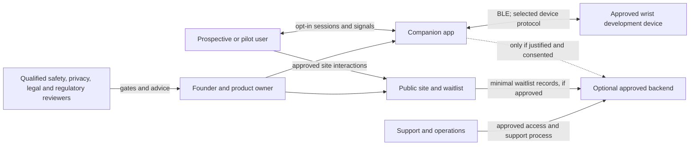

# Enterprise Architecture — AuraSync

> **Document control:** Version 0.2 | Status: Proposed target architecture; awaiting founder/technical approval | Owner: Enterprise / technical architect (TBD) | Last reviewed: 2026-11-20

**Architecture level:** Startup enterprise view, intentionally lean  
**Authority:** [Qwen implementation backlog](../../QWEN_IMPLEMENTATION_TASKS.md)

## 1. Architecture intent

Provide a coherent path from customer discovery to a safe wellness pilot and, only if justified, a commercial product. Maintain clear separation between the public acquisition experience, companion app, device integration, personal data, and business operations. Avoid enterprise-scale complexity until actual scale or control needs justify it.

## 2. Business capability map

| Capability | Initial need | Later capability (approval required) |
|---|---|---|
| Product and claims governance | Approved scope, copy, and release gates | Change-control and multi-market review |
| Customer experience | Information site and optional waitlist | Companion app, support, commerce |
| Device experience | Development-kit onboarding and connection | Production firmware, fleet/service lifecycle |
| Wellness interaction | User-controlled breathing/guidance | Evidence-based personalization, if validated |
| Research and learning | Approved usability and feasibility tests | Governed study operations and analytics |
| Data/privacy operations | Consent, minimization, access, deletion | Account/cloud sync only if justified |
| Commercial operations | Waitlist support | Inventory, payment, returns, fulfillment |
| Trust and operations | Basic monitoring, incident ownership | Formal service objectives and continuity |

## 3. Stakeholders and system context

The platform is optional, not assumed. No direct device-to-cloud path is proposed for V1. Do not route raw sensor streams to an external service without an approved purpose, user notice, security design, and retention plan.

## 4. Application and domain boundaries

1. **Public experience:** approved product information, privacy/terms, support, optional waitlist.
2. **Companion experience:** onboarding, permissions, device connection, quality-aware measurements, user-controlled sessions, check-ins, settings, and data controls.
3. **Device adapter:** protocol/SDK translation, connection lifecycle, timestamping, signal metadata, and a simulator; it does not infer a diagnosis.
4. **Wellness rules:** deterministic, versioned, opt-in rules. Separate from raw acquisition and user-entered check-ins. No unvalidated emotion model.
5. **Data services (conditional):** consent, waitlist handling, account/sync only if approved, deletion, audit, and support. Keep the public waitlist store logically separate from sensor history.
6. **Operations and governance:** build/release, monitoring, access, incident handling, supplier/device verification, claims and market approvals.

Prefer a modular application or monolith with explicit interfaces at this stage. Split components or services only when a measured operational, security, team, or scaling need exists.

## 5. Information architecture and classification

| Information | Initial classification | Default handling |
|---|---|---|
| Public approved product copy | Public | Version and review claims |
| Waitlist contact and consent | Personal | Minimum fields only; no collection until notice and retention schedule are approved |
| Raw sensor samples | Sensitive personal / potentially health-related | Avoid central collection by default; local processing where feasible; assign owner/schedule before capture |
| Derived HR/HRV/signal-quality values | Sensitive personal / potentially health-related | Label as estimates; disclose purpose; restrict/delete; schedule by purpose |
| Self-reported calm/check-ins | Sensitive personal | Optional, separate from sensor data, never infer missing responses; schedule separately |
| Device identifiers and diagnostics | Personal/pseudonymous depending on linkage | Minimize/unlink where feasible; define schedule and owner |
| Orders/payment references (future) | Personal/financially sensitive | Use an approved payment provider; do not store card data |
| Credentials, tokens, secrets | Restricted | Managed secret storage; never commit or log |

These classifications are conservative design assumptions, not legal determinations. Qualified reviewers must confirm them for the selected market.

For each collected category, the accountable data owner must record purpose, system of record, access roles, retention trigger/duration or deletion rule, backup behavior, legal-hold exception, and deletion evidence in an approved schedule before collection. Qualified counsel must review it for the launch market; track this under F1.7/F2.3.

## 6. Cross-cutting architecture principles

- **Identity:** no account by default for local prototype; if introduced, use an approved identity provider, least privilege, secure session handling, and account deletion.
- **Consent:** tie each collection/use to an explained purpose, versioned notice, and clear opt-in/withdrawal.
- **Quality:** carry source, timestamp, device/protocol version, and quality status with measurements; unavailable is a valid state.
- **Security:** encrypt transport and stored sensitive data where applicable; minimize access; protect administrative paths; log access without logging raw signals.
- **Interoperability:** isolate device SDK and hosting/payment provider behind replaceable adapters.
- **Availability:** degrade safely when offline, disconnected, or sensor quality is poor; guidance remains user-controlled.
- **Observability:** collect service health and privacy-safe operational events; analytics are separately approved.
- **Accessibility:** keyboard/screen-reader/mobile accessible web; app controls support stopping and opting out.
- **Decision traceability:** maintain ADRs for material choices and link task acceptance evidence in the implementation tracker.

## 7. Target-state technology view

The logical target is a web experience, companion client, device adapter, and optional backend. Specific frameworks, databases, cloud, analytics, CI provider, and identity/payment vendors remain **TBD** until repository inspection, requirements, cost review, and founder approval.

Do not begin with Kubernetes, microservices, streaming infrastructure, machine-learning pipelines, or cloud sensor ingestion. They have no validated need in the current concept.

## 8. Transition architecture

| Stage | Architecture state | Gate |
|---|---|---|
| Discovery | Research, approved claims, static prototype | Founder confirms target/user and scope |
| Pre-launch | Reviewed public site; minimal waitlist only if approved | Privacy notice, support, accessibility, preview sign-off |
| Prototype | Companion app, dev-kit adapter, simulator, local/minimized data | Device feasibility and data-quality review |
| Pilot | Controlled cohort, consent, support, incident and study controls | Required protocol/oversight and safety approval |
| Production candidate | Verified hardware, hardened services, release/restore process | Legal, safety, privacy/security, operational sign-off |
| Staged launch | Limited release with monitoring and pause/rollback | Evidence and capacity support expansion |

## 9. Architecture governance

Maintain a small ADR log. Each decision records context, options, decision owner, consequences, status, date, and revisit trigger. Require review when a change adds a new data purpose, sensitive-data flow, third party, market, medical claim, sensor, paid capability, or production dependency. The founder owns business choices; the CTO owns technical recommendations; qualified specialists own advice in regulated domains.
