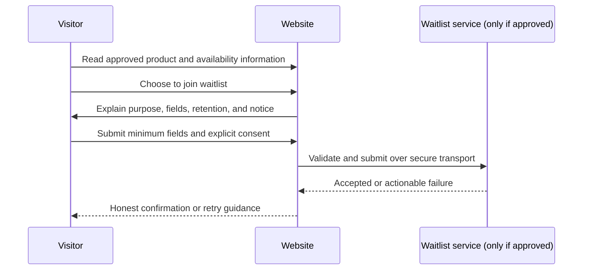

# Solution Design 01 — Pre-launch Experience

**Status:** Proposed; no stack or provider selected  
**Goal:** Learn whether the approved product concept is relevant while offering a truthful, privacy-reviewed waitlist.  
**Related:** [Implementation backlog](../../QWEN_IMPLEMENTATION_TASKS.md), [Enterprise Architecture](../architecture/enterprise-architecture.md)

## 1. Scope

### In scope

- Responsive, accessible public site using only approved product language.
- Clear distinction between concept, prototype, pilot, and availability.
- Optional waitlist with the minimum approved contact information and purpose-specific consent.
- Privacy/terms/support links approved for the launch market.
- Preview environment, basic availability/error monitoring, and rollback instructions.

### Out of scope

- Product checkout, deposits, delivery promises, inventory claims, clinical claims, or testimonials not explicitly substantiated and approved.
- Demo or fake Google authentication, OTP, Stripe/payment forms, and fake SMS.
- Collecting sensor data, mood history, precise location, or unnecessary profile details on the marketing site.

## 2. User journey



If no backend or privacy approval exists, use a founder-approved manual interest-capture process or do not collect entries. Never silently send form data to an unreviewed third party.

## 3. Data and behavior

Proposed minimum record, subject to privacy review:

```text
WaitlistEntry
- id: opaque identifier
- email: required only if approved
- name: optional only if needed
- consent: purpose, notice version, timestamp, and withdrawal status
- created_at: timestamp needed for operation/retention
- status: pending | confirmed | withdrawn | deleted
```

Do not collect a phone number or require OTP by default. Do not enable marketing messages from waitlist consent alone unless the notice and applicable rules explicitly support it. Avoid storing IP addresses or user-agent strings except for a documented short-lived abuse/security purpose with a defined retention.

### Validation and abuse controls

- Validate fields on the client for usability and on the server for enforcement.
- Normalize email consistently; use idempotent submission behavior so retries do not create duplicate entries.
- Apply proportionate rate limits and bot controls approved for the data flow.
- Do not reveal whether a particular email is already registered if that creates an enumeration risk.
- Return clear success, validation, unavailable, and retry states; do not show success when persistence failed.

## 4. Security and privacy

- Use HTTPS and secure provider-side storage if a backend is approved.
- Restrict waitlist export and administration to named roles; log administrative access without logging contact contents.
- Define retention, export/deletion, withdrawal, support, and incident procedures before collecting real entries.
- Keep secrets server-side in managed configuration; no privileged key in browser code.
- Use only necessary cookies/analytics, with required notices/consent. Analytics are off until approved.

## 5. Verification

- Unit and end-to-end coverage: required/optional fields, malformed values, consent, duplicates, rate limiting, service failure/retry, and deletion/withdrawal.
- Manual accessibility review: keyboard-only use, focus order, labels/errors, contrast, screen-reader announcements, zoom and small-screen layout.
- Content review: claims match approved matrix; no invented pricing, stock, endorsements, evidence, or launch date.
- Operational check: preview deployment, HTTPS, monitoring, support route, and rollback.

## 6. Release gate

May go live only as a **non-paid, accurately described pre-launch site** after founder approval of copy and qualified review of data collection/notices. If those approvals are unavailable, disable the form rather than collect personal data.
